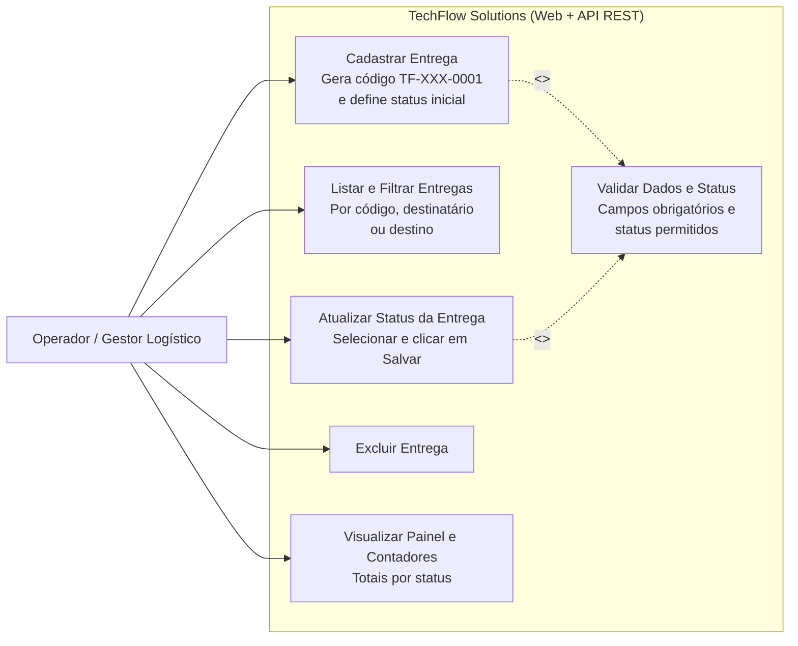
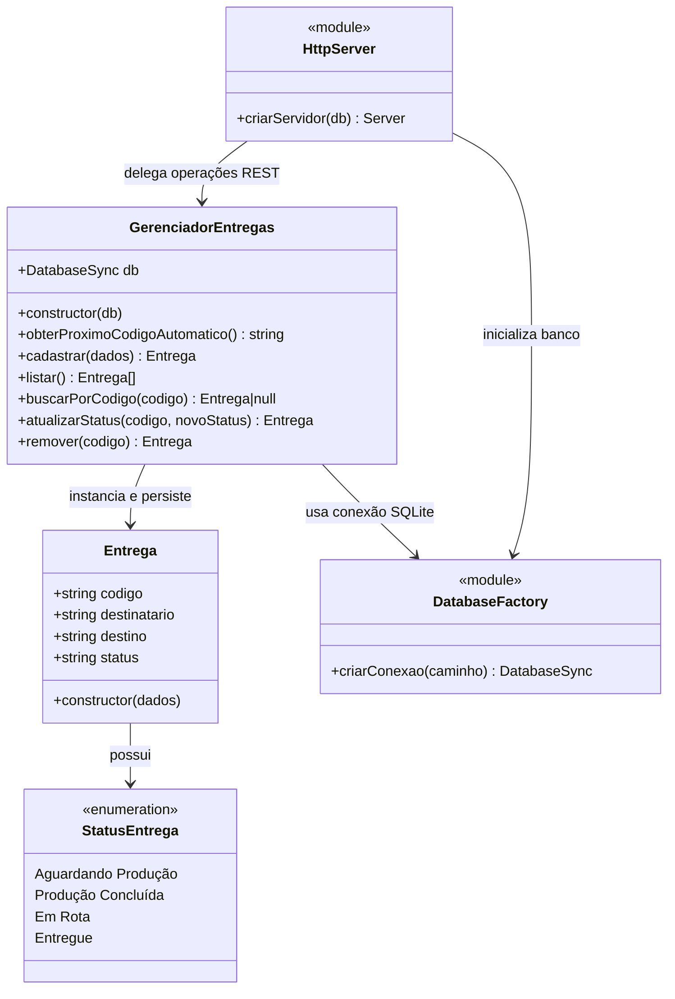
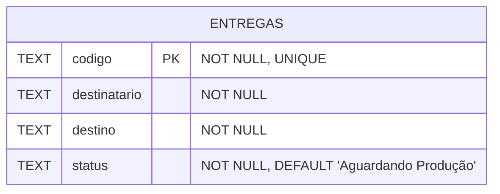
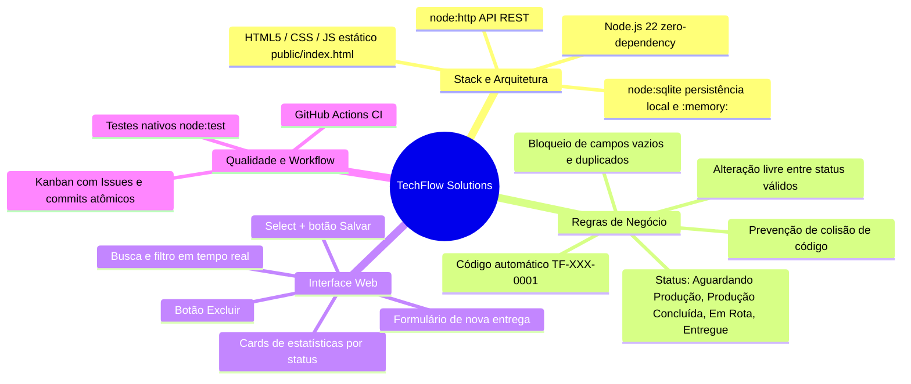

mkdir -p docs
cat << 'EOF' > docs/diagramas.md
# Documentação Técnica e Diagramas — TechFlow Solutions

## 1. Diagrama de Casos de Uso (UML)

## 2. Diagrama de Classes (UML)

## 3. MER — Modelo Entidade-Relacionamento

* **Entidade:** `ENTREGA`
  * `codigo` (PK): identificador único no formato `TF-XXX-0001`, sem duplicidade.
  * `destinatario`: nome ou identificação de quem recebe a entrega (obrigatório).
  * `destino`: local/cidade de destino (obrigatório).
  * `status`: estado atual no fluxo logístico (`Aguardando Produção`, `Produção Concluída`, `Em Rota`, `Entregue`), iniciando em `Aguardando Produção`.

## 4. DER — Diagrama Entidade-Relacionamento (`node:sqlite`)

## 5. Mindmap — TechFlow Solutions

EOF